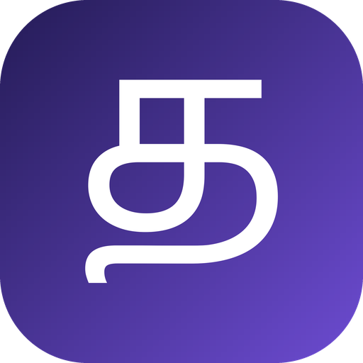

<p align="center">
  
</p>

<h1 align="center">Tanlish Translate</h1>

<p align="center">Type Tanglish with your normal keyboard and tap one small floating button, or press and hold it
and just speak Tamil: either way the English lands in the field you were in.</p>

## What it is

Tanglish is Tamil written in Latin letters — *vanakkam nanba epdi irukka*. You type it with whatever
keyboard you already use, in whatever app you are already in. Then one tap on the floating **த**
button and the sentence in that field becomes *Hello friend, how are you?*

- **Any app** — WhatsApp, Messages, Gmail, Chrome. Anything with a text field.
- **One tap for the whole sentence**, not a keyboard to learn and not a word-by-word popup.
- **Press and hold to speak** — say it in Tamil instead of typing and the English is in the same
  field. End the sentence by letting go, or by tapping the button if you would rather take your time
  saying it.
- **Each sentence is only ever translated once** — the result is saved on the device, so a phrase you
  use again costs nothing and works with no connection at all.
- **Adjustable opacity** — a slider in the app sets how see-through the circle is over your apps.
- **Undo** — a six-second chip puts your text back, whichever way the English got there.

The button only appears while the keyboard is up. Drag it anywhere; to get rid of it, turn off
"Floating button" in the app.

Typed Tanglish is translated by AI at `easytamiltyping.com`, so a phrase that has never been
translated before needs an internet connection. There is no offline dictionary: when a request cannot
be made, the button says so and leaves your text exactly as you typed it.

## Install

Download `app-release.apk` from the [latest release](https://github.com/Kirisos-Guna/tanlish-translate/releases/latest)
and open it on your phone, allowing installation from this source when Android asks.

Then the one-time steps, all on the app's own setup screen:

1. **Display over other apps** — lets the button float above other apps.
2. **Switch on the accessibility service** — lets the button read the field you are in *at the moment
   you tap*, and write the English back.
3. **Show the button** — the switch that puts the circle on screen, and the only way to take it off
   again.
4. **Allow the microphone** — only needed to speak instead of type. Skipping it leaves the tap path
   exactly as it was.

> **Sideloaders on Android 13+:** Android greys out the accessibility toggle for apps that were not
> installed from a store. Open **App info → ⋮ (top right) → Allow restricted settings**, then come
> back and the toggle works.

If you already have an older build of this app installed from a different signing key (an Android
Studio run, for instance), Android will refuse to install over it — uninstall that first. Doing so
clears its cached translations, quota counter and settings.

## Speaking instead of typing

Hold the button down and speak Tamil. How it stops is up to you — either letting go of the button,
or tapping it when you have finished. The words are read back to you in the pill beside the button
while you talk, and a few moments after the session ends the English replaces the field you were in —
the same field the tap path writes to, with the same Undo.

- **Tamil script, not Tanglish.** A microphone cannot hear romanised Tanglish, so the recogniser is
  asked for Tamil (`ta-IN`) and its Tamil script is translated into English. That is why speaking
  needs the phone's Tamil speech support: if the recogniser has none it says so, rather than quietly
  listening for English words.
- **Two ways to end a sentence**, chosen on the app's setup screen. *Hold to talk* keeps the
  microphone open only while your finger is down: let go and the English is written. *Tap to stop*
  starts on the hold, keeps listening while you say the whole thing at your own pace, and writes the
  English when you tap the button again. Tap to stop asks the recogniser to wait through a pause in
  the middle of a sentence; a recogniser that ignores that request writes the English early instead,
  as soon as you stop talking.
- **Only while you listen.** Android records nothing until the button is pressed, and the microphone
  closes the moment the session ends — when your finger comes up, or when you tap the button.
- **A listening notice is required.** Android does not let a background app keep the microphone open
  without a foreground service, so a small "Listening in Tamil" notice appears in the notification
  shade while you hold the button and goes when you let go. On Android 13+, allowing notifications
  lets you see it; denying them does not stop listening.
- **A voice translation is capped at 150 characters** — one utterance, not a monologue.
- **Turning off "Allow AI translation" stops it too.** A hold then does not open the microphone at
  all: the words could not be translated back, so nothing should be listened to for nothing.
- **Where the words go.** The Tamil is sent to Google's keyless translate endpoint, with MyMemory's
  free API behind it if Google refuses. Both need no key and no account, and both keep working with
  the typed path's quota spent, since they are budgeted separately.

Tamil speech support comes from whichever recognition service the phone ships with (Google's, on most
phones) and may need the Tamil language downloaded once in your keyboard's voice typing settings.

### When a hold does nothing

The press, the microphone and the recogniser all log under one tag, so a failure can be read off a
phone instead of guessed at — with the phone on USB debugging:

```bash
adb logcat -s Tanlish
```

`press -> StartListening` means the hold was read correctly; if it never appears, the press is not
reaching the service. `the microphone is open` means Android allowed the session. A recogniser error
is logged as its number *and* its name, which is usually the whole diagnosis: 9 is the microphone
never allowed, 12 and 13 are a recogniser with no Tamil, and `never answered` means the session
started and nothing came back. Only a short preview of the recognised words is ever logged.

## What it reads and what it sends

| | |
|---|---|
| Reads | Only the focused text field, and only when you tap the button. Nothing is read while you type, and password fields are skipped entirely. Holding the button reads the microphone instead; never both at once. |
| Sends | On a tap, that field's text goes to `easytamiltyping.com`. On a hold, the Tamil the recogniser heard goes to `translate.googleapis.com`, or to `api.mymemory.translated.net` if Google will not answer. Switching **Allow AI translation** off stops both, and a hold then does not even open the microphone. Results are cached on the device, so repeating a phrase costs nothing. |
| Free tier | The typed endpoint allows roughly **15 requests an hour**, and says so when the budget is spent. The two spoken endpoints are keyless web services with no published quota of their own: `client=gtx` is undocumented and rate limited per IP, and MyMemory allows 5,000 characters a day anonymously. |
| Fails safely | Apps that refuse programmatic edits get the translation on the clipboard instead of having their field rewritten, and a translation that never arrived leaves the field untouched. |

## Building

Needs JDK 21 and Android SDK 37 (`compileSdk 37`, `minSdk 24`).

```bash
./gradlew :app:testDebugUnitTest   # unit tests (no network, no device)
./gradlew :app:assembleDebug       # app/build/outputs/apk/debug/app-debug.apk
./gradlew :app:assembleRelease     # signed only if keystore.properties is present
```

### Signing

Release signing reads `keystore.properties` (gitignored) pointing at `keystore/tanlish-release.jks`
(also gitignored). Without those files the release build still assembles, unsigned, so a clone can be
built by anyone. The real key is deliberately not in this repository: a clone can build its own APK,
but it cannot sign as this app. Back that keystore up — losing it means future versions can never be
installed as an update, only as a fresh install.

### Icons

One mark, **த**, drawn as vectors: `drawable/ic_launcher_foreground.xml` for the adaptive icon,
`ic_launcher_monochrome.xml` for Android 13+ themed icons, `ic_app_mark.xml` for the badge on the app's
own screen and `ic_bubble_mark.xml` for the floating button. The WebP files under `mipmap-*` are the
legacy pre-API-26 raster copies of the same tile, and are the one set that has to be redrawn by hand if
the mark ever changes.

The shape is traced from Microsoft's Nirmala UI. That is fine for a personal build; a store release
should redraw it as original artwork.

## Layout

| Path | What lives there |
|---|---|
| `overlay/` | The floating button: its window, drag and snap, placement maths, boot restore |
| `accessibility/` | Reading the focused field, rewriting it, and noticing when the keyboard is up |
| `translate/` | The button's decision core: what to translate, what was spoken, and when to fall back |
| `speech/` | Listening itself: the recogniser, the errors it reports and the microphone permission |
| `engine/`, `net/`, `data/` | Where a sentence gets translated, the endpoint clients, the translation cache and quota bookkeeping |

## Notes

Typed translation comes from easytamiltyping.com's public endpoint, and spoken translation from
Google's undocumented `client=gtx` endpoint with MyMemory behind it. All three are free public web
services that may change or disappear at any time; `net/EasyTamilTypingApi.kt`,
`net/GoogleTranslateApi.kt` and `net/MyMemoryApi.kt` are the three places that would need updating if
they do. This is an unaffiliated personal project. No licence is granted yet — all rights reserved.
